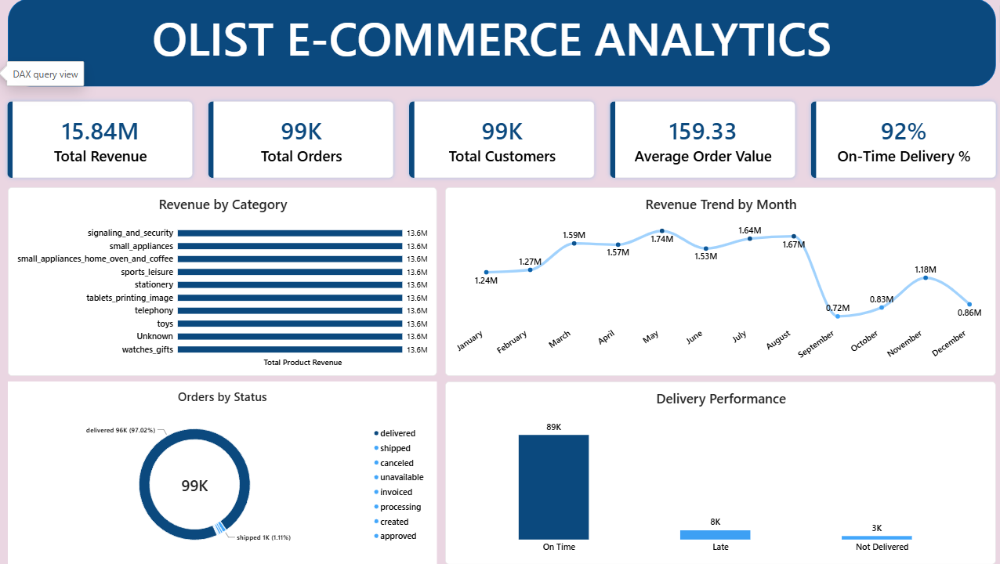
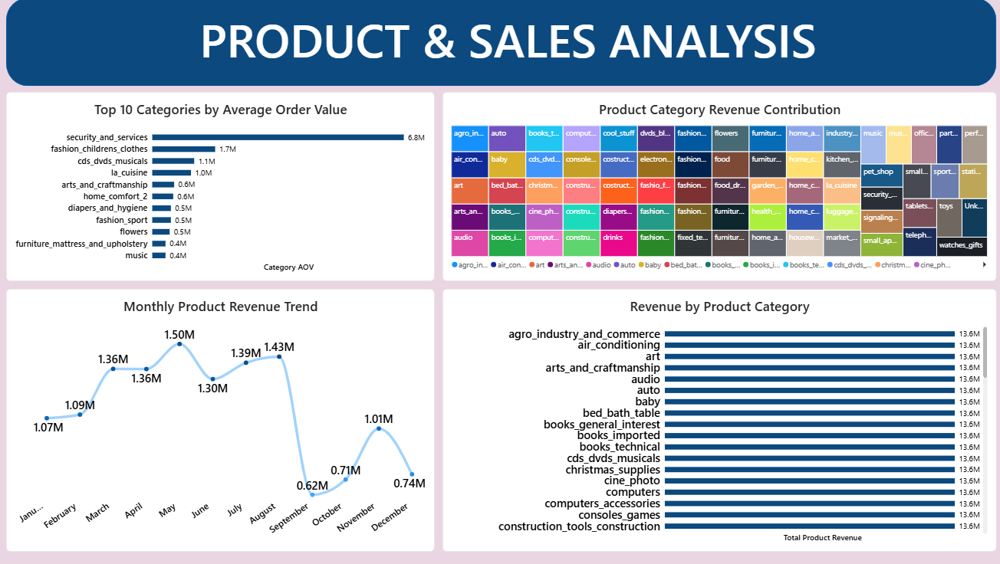
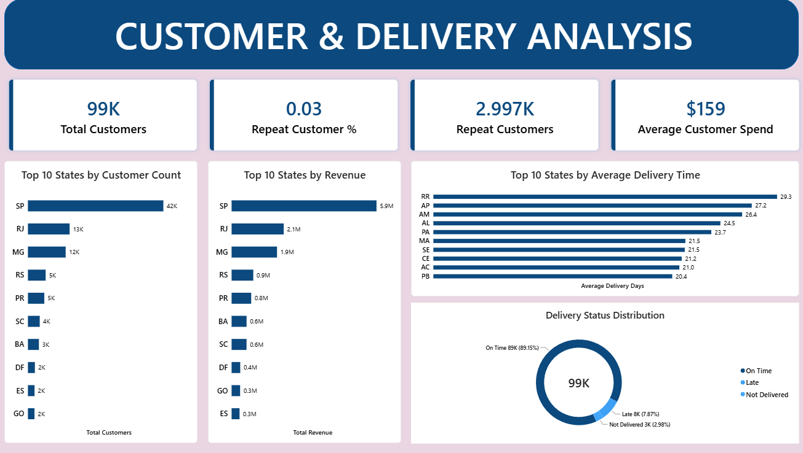

# Olist E-Commerce Analytics Engineering Project

## Project Overview

An end-to-end Analytics Engineering project built using
AWS S3, Databricks, dbt Core, SQL, and Power BI.

The project transforms raw Brazilian e-commerce data into
analytics-ready datasets using a Bronze, Silver, and Gold
data architecture.

## Technology Stack

- AWS S3 — Data storage
- Databricks — Data processing and analytics
- SQL — Data transformation
- dbt Core — Data modeling and testing
- Power BI — Business intelligence and visualization
- GitHub — Version control and project documentation

## Data Architecture

### Bronze Layer

Contains 9 raw Olist e-commerce tables.

### Silver Layer

Contains 15 dbt models:

- 9 staging models
- 6 intermediate models

Transformations include:

- Data type conversion
- Data standardization
- Data enrichment
- Business logic
- Data aggregation

### Gold Layer

Contains 6 analytics-ready models:

Dimensions:
- dim_customers
- dim_products
- dim_sellers
- dim_date

Facts:
- fct_orders
- fct_order_items

## dbt Features

- Modular SQL transformations
- Source and model documentation
- Data quality testing
- Incremental fact model
- Model lineage and dependencies
- Star schema modeling

## Power BI Dashboard

The Power BI report contains three pages.

### 1. Executive Overview

### 2. Product & Sales Analysis

### 3. Customer & Delivery Analysis

## Key Business Metrics

- Total Revenue
- Total Orders
- Average Order Value
- Total Customers
- Repeat Customers
- On-Time Delivery Percentage
- Average Delivery Days
- Product Category Revenue

## Project Structure

- dbt/ — SQL models, tests, and configuration
- powerbi/ — Dashboard and screenshots
- architecture/ — Data architecture diagram

## Dataset

Brazilian E-Commerce Public Dataset by Olist,
available on Kaggle.

## Author

Analytics Engineering Portfolio Project